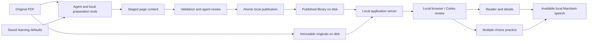

# Interactive reader system design

Status: architecture originally recorded 2026-11-20; visual design and review preferences updated 2026-11-22. The React reader and preparation tools are implemented; see the implementation guide for delivered behavior.

## Purpose and authority

Build a personal Chinese learning library around the original PDF: **Reading → Understanding → Pronunciation → Practice → Return to reading**. The source page stays central, while concise English teaching helps a complete beginner understand and practise its content.

Follow the [current requirements](current-requirements.md) for product scope, the [content contract](content-contract.md) for data, and the [local library workflow](local-library-workflow.md) for operation. This design makes those requirements concrete without selecting a framework, PDF renderer, or extraction library. Later explicit user decisions take precedence. The [design guidelines](design-guidelines.md) explain the existing interaction and accessibility principles; the visual tokens here are project choices, not Apple requirements.

## System structure

Separate content preparation from studying. An agent prepares requested physical pages and publishes reviewed material to disk. The browser consumes that material without an agent session or internet connection.

The server starts through `npm start`, binds to loopback by default, serves bundled application assets and library files, and discovers published manifests. Initial setup follows the documented npm installation flow. No runtime dependency may require a remote dictionary, CDN, LLM service, account, or analytics endpoint.

| Boundary                    | Responsibility                                                                                               |
| --------------------------- | ------------------------------------------------------------------------------------------------------------ |
| Preparation tools and agent | Inspect selected pages, extract and align text, author explanations/questions, review, validate, and publish |
| Original storage            | Preserve unchanged PDF bytes once under `data/pdfs`                                                          |
| Staging                     | Isolate incomplete preparation and targeted repairs under `data/staging`                                     |
| Published library           | Keep versioned manifests, page content, assets, and review evidence under `data/library`                     |
| Local server                | Serve allowed local paths, derive the catalog, detect publication, and deliver coherent revisions            |
| Browser reader              | Render faithful pages, aligned annotations, equivalent accessible text, and persistent consultation details  |
| Practice engine             | Select eligible reviewed questions, grade by stable option ID, explain results, and retry mistakes           |
| Speech adapter              | Detect usable local Mandarin voices, play deliberately, prevent overlap, and expose failures                 |
| In-memory session state     | Retain reading location, active item, practice selection, answers, and results during navigation             |

Learning content persists across restarts. Personal reading and practice progress is held in memory only; closing or reloading may reset it. Saved preparation defaults are repository configuration, separate from personal progress.

## Content and revision design

Use the package records and file formats in the content contract rather than embedding lesson text or coordinates in application components. The model separates the immutable source, page transcript and geometry, reusable linguistic entries, individual source occurrences, and practice questions.

Each occurrence points to a physical page, extraction revision, exact source quote, Unicode code-point range, and genuine character geometry. Repeated words keep distinct occurrence IDs. Overlay positions come from the same page viewport transform as the source renderer; never divide a line box evenly to invent character positions. An accessible text companion provides equivalent annotation access alongside the original page.

Prepare only requested pages. Adding page 3 leaves previously prepared page 1 files, IDs, and extraction revision unchanged. Repeating a ready-page request skips it; changing accepted material requires an explicit repair or reprepare scope. Keep page preparation state separate from question availability, and exclude uncertain records from ready details and practice.

Publication validates a staged revision and switches to it atomically, retaining a recoverable prior revision. Detect stale concurrent changes before publishing. The server discovers additions without a rebuild or restart. Pin an open document and its practice session to one coherent revision; announce updates quietly and let the learner load them when convenient. Do not combine old coordinates with new explanations.

A quiet **Copy reference** action identifies the document, physical page, stable item ID, and observed content revision. Provide selectable text if copying fails. Corrections resolve that exact item, preserve its identity, and revalidate dependent questions.

## Navigation and screen layout

| View            | Main content                                                    | Supporting controls                                                                                        |
| --------------- | --------------------------------------------------------------- | ---------------------------------------------------------------------------------------------------------- |
| Library         | Published documents and physical page preparation states        | Open document; concise availability or error messages                                                      |
| Reader          | Faithful original page with aligned interactive regions         | Library return, page navigation, practice selection, text companion, details                               |
| Item details    | Chinese form, contextual English meaning, tone-mark pinyin      | Explicit playback, character/word exploration, expandable grammar and IPA, Add to practice, Copy reference |
| Practice        | One prompt, equal answer choices, then feedback and explanation | Check answer, Continue, source context, Return to reading                                                  |
| Session results | Answer counts, mistakes, and explanations                       | Retry mistakes and Return to reading                                                                       |

On a wide window, place the reader in the main area and persistent details beside it. A page outline may collapse; do not reserve three permanent columns. Size the source area first and show the detail panel only when there is enough space for both to remain readable.

On narrow windows or with enlarged interface text, switch details to a focused view or sheet with a visible return action. Preserve page aspect ratio and allow normal zoom/panning where needed. Reflow the interface controls without reconstructing, recolouring, or cropping the source page. Returning from details or practice restores the source anchor and meaningful session state.

## Visual design, typography and spacing

The [current visual design and reference roles](design-references/README.md) are the authority for interface styling. Reference 2 supplies the restrained editorial structure; reference 1 supplies Geist typography, colors and finishing details. These replace the earlier Navy/Teal/Beige palette, system-font default, rounded panels and automatic dark appearance.

Use white surfaces, near-black text, blue actions, spacious sections and fine dividers. Keep original PDF artwork unchanged. See the linked specification for exact tokens, dimensions, responsive behavior and component states. The references are design inputs, not runtime assets or page templates.

## Interaction and component rules

### Annotations and consultation

Hover may open one compact preview with form, pinyin, and short meaning. It never steals focus or replaces explicit selection. Click, tap, or keyboard activation selects an occurrence and opens persistent details. Prefer the word at the selected position, then offer its characters, expression, and sentence within the same detail hierarchy.

Distinguish availability, hover, selected occurrence, keyboard focus, browser text selection, and practice membership. Use a visible outline or marker as well as fill; source overlays should remain restrained and must not obscure the original glyphs. Dense annotations have equivalent controls in the accessible text companion instead of overlapping oversized hit targets.

The detail view starts with Chinese form, contextual English meaning, and pinyin. Playback is explicit. Character breakdowns, relevant grammar, and separately labeled IPA expand on demand. Omit absent optional fields. Prefer source examples; any useful supplemental example is labeled and normally limited to one per item. Keep technical IDs behind Copy reference.

### Buttons and feedback

Use blue primary buttons with white text and quiet secondary controls with near-black labels. Reserve primary prominence for the next meaningful action, such as Open document, Start practice, or Check answer. Icon-only controls need accessible names; unfamiliar actions receive visible labels. Hover and pressed feedback must not shift layout.

Selected practice items show a check and an action such as Remove from practice. Audio controls show playing, stopped, unavailable, and failed states in context. An empty practice selection explains how to add material. An unprepared page stays readable and is labeled Not prepared; it does not imply that explanations already exist.

### Practice and pronunciation

Use one single-answer multiple-choice engine for the required categories. Present choices with equal prominence before submission, separate selection from Check answer, and retain the explanation before Continue. Grade using option IDs so shuffling cannot change correctness. Questions require reviewed source references and one defensible answer; insufficient material produces an explanation rather than filler questions.

Keep recognition answers from leaking through auxiliary translations or pinyin. Limit selected-material practice to questions within that selected source scope. Show session results as session counts, not language mastery.

Speech uses an available local Mandarin voice. Prefer reviewing playback and its unavailable state in the agent browser, such as the Codex browser; record when audible or disconnected playback cannot be verified. Selecting an annotation never starts audio. A new utterance stops the previous one. Without working local speech, show an unavailable state and omit audio-dependent questions while retaining text study and pronunciation notation.

### Motion and accessibility

Use brief, interruptible transitions only to clarify opening, dismissal, or state changes. A 120–200 ms fade is a prototype starting point, not a platform requirement. Respect reduced motion and avoid decorative bouncing or celebration.

Provide semantic controls, visible focus, language metadata, logical keyboard order, and sensible focus restoration. Escape dismisses the active temporary surface when appropriate. Modal sheets manage focus; ordinary side panels remain nonmodal. Preserve browser scrolling, copy, zoom, and navigation. Check the complete loop with keyboard, assistive reading, and 200% text enlargement, with status understandable without colour or audio.

## Implementation decisions and acceptance

The framework, supported Node.js version, extraction/OCR dependencies, PDF renderer versus verified page assets, update detection mechanism, and atomic revision storage strategy remain implementation choices. Compare rendering candidates using Lesson 1 fidelity, alignment, clarity, size, accessibility, and offline cost. Record the chosen approach and its evidence before depending on it. Measure performance on the actual source and target browsers before setting budgets.

Acceptance follows the [delivery plan](delivery-plan.md) and [design review checklist](design-guidelines.md#25-design-review-checklist). In particular, verify:

- The complete reading, consultation, pronunciation, practice, and return loop in the agent browser, preferably the Codex browser, recording the review environment, local voice results and capability limits.
- Faithful page rendering and aligned character, word, and multiline regions after resizing and zoom.
- Keyboard and text-companion access, enlarged text, measured contrast, visible focus, and the selected light appearance and reduced-motion behavior.
- Offline restart and study from durable local content, without an agent or runtime network services.
- Incremental page additions and targeted corrections preserve unrelated accepted content and stable IDs.
- New publications appear automatically without interrupting active study or mixing revisions; failed updates preserve the last usable package.
- Unprepared pages, missing audio, insufficient questions, and isolated content uncertainty remain honest and recoverable.

This document defines the direction for later implementation. It does not authorize application construction, source-page preparation, or external publication.
